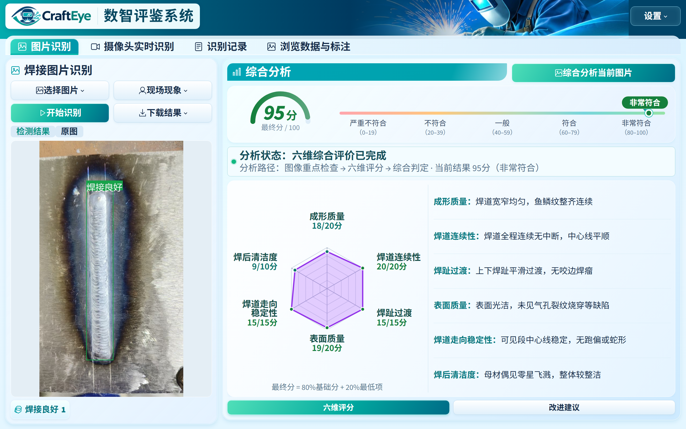
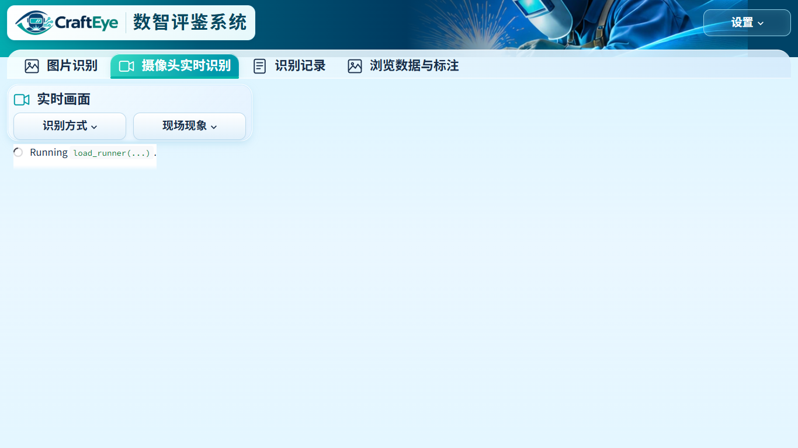
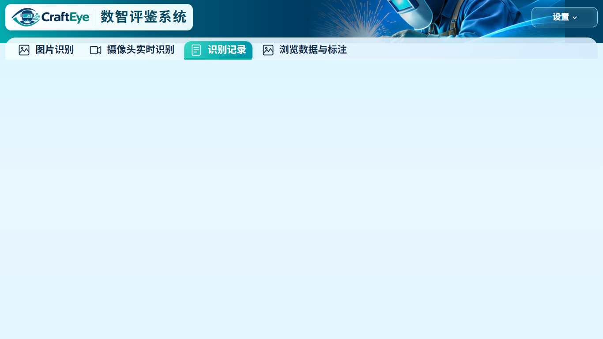

# CraftEye 数智评鉴系统

CraftEye 是面向中职焊接实训的本地视觉检测与综合评价系统。它把焊缝图片检测、摄像头取帧、六维外观评分、缺陷参考和训练记录放在同一个单屏工作台中，帮助学生看懂问题并知道下一步怎么练。

## 功能展示

### 1. 图片识别与综合评价

上传图片后，系统用本地 YOLO 模型定位焊接区域，展示检测结果，并生成六维外观评价、综合分和改进建议。



### 2. 摄像头实时识别

可选择手动或自动识别。手动模式点击截取当前画面，自动模式在连续完成 10 帧检测后自动截取；截取后摄像头关闭并进入综合分析。



### 3. 识别记录与成长曲线

每次完成的综合分析会保存原图、检测结果、评分和完整详情。记录表与成长曲线使用同一份本地数据库，支持查看、删除和导出。



### 4. 六维评分

系统从成形质量、焊道连续性、焊趾过渡、表面质量、焊道走向稳定性和焊后清洁度六个可从图片观察的维度进行评价。雷达图保留各维度真实得分，综合分会考虑短板。


## 快速启动

### Windows 便携版

下载发布页中的 `CraftEye-v4.1-Lite-Windows-x64.zip`，完整解压后双击 **启动网页.cmd**。包内已经包含 Python 运行环境、CPU 推理依赖、ONNX 模型、页面资源和数据集，不需要另外安装 Python、Node.js 或 Git。

### 从源码运行

```powershell
.\.venv\Scripts\python.exe -m streamlit run app.py
```

浏览器打开 <http://127.0.0.1:8501>。图片检测可以离线完成；综合分析需要联网访问通义千问接口。API Key 只应放在本机 `.streamlit/secrets.toml` 或网页设置中，不要提交到 Git。

## 技术原理

1. **YOLO 目标检测**：对输入图片进行预处理，定位焊缝及可见缺陷区域，输出类别、边界框和置信度。置信度只表示检测可信程度，不是质量评分。
2. **重点区域分析**：筛选置信度高于 60% 的检测框，裁出带周边的局部区域，与原图一起用于综合判断。
3. **六维外观评价**：综合分析只评价图片中能直接观察到的外观证据，输出六个维度的分数和理由；无法从图片确认的内容不会伪造实测结论。
4. **短板约束评分**：基础加权分与最低维度共同决定最终分，关键可见缺陷还会触发教学限分，避免某一项很差却被其他高分掩盖。
5. **本地记录**：原图、检测图、评分快照和报告保存在 `outputs/recognition-history.sqlite3`，刷新或重启后仍可查看。

## 主要功能

- 图片上传、示例图片和历史原图选择
- YOLO 检测框、类别标签和检测数据导出
- 摄像头手动截取与自动 10 帧识别
- 六维评分、雷达图、五档进度条和改进建议
- 缺陷参考图对比
- 识别记录、详情 ZIP、删除、CSV 导出和成长曲线
- 训练集、验证集、测试集图片与标注浏览
- Windows 一键启动、停止和自动打开浏览器

## 项目结构

```text
app.py                  兼容启动入口，转入 website/app.py
website/                网页运行代码、样式和评价提示词
  app.py                Streamlit 页面入口
  inference.py          YOLO / ONNX 推理与检测框绘制
  ai_analysis.py        综合分析请求与响应校验
  scoring.py            六维评分和统一结论
  camera_ui.py          摄像头取帧、截取和识别模式
  recognition_history.py 识别记录与图片存储
assets/                 页面素材、示例图和缺陷参考图
models/                 模型来源说明与本地权重
dataset/                训练、验证、测试图片和标注
packaging/windows/      Windows 启动器和使用说明
docs/screenshots/       README 功能截图
```

网页依赖的 Python 代码全部集中在 `website/`；`tests/` 和 `scripts/test_*.py` 只用于开发验证，不会被网页或 Windows 便携版运行时加载。

## 数据与模型来源

- 数据集：[the-welding-defect-dataset-v2](https://huggingface.co/datasets/avinashhm/the-welding-defect-dataset-v2)
- 预训练权重：[welding-defect-yolov8-full-training](https://huggingface.co/avinashhm/welding-defect-yolov8-full-training)
- 应用使用作者已训练权重，没有在本项目中重新训练。

## 开发检查

```powershell
.\.venv\Scripts\python.exe -m unittest discover -s tests -v
.\.venv\Scripts\python.exe scripts/verify_install.py
```

系统检查记录见 [SYSTEM_CHECK.md](SYSTEM_CHECK.md)，展示说明见 [SHOWCASE.md](SHOWCASE.md)。
Python 文件按网页运行、模型推理、评分记录和开发验证归类，详见 [docs/PYTHON_FILES.md](docs/PYTHON_FILES.md)。

## 注意事项

- 只监听本机 `127.0.0.1`，不会自动向局域网公开。
- 本地检测不需要联网；综合分析、评分建议需要可用的 API Key 和网络。
- 图片只能评价可见外观，不能代替电流、速度、角度或接头强度等现场实测。
- 不要把 `.streamlit/secrets.toml`、本机数据库和个人图片提交到公开仓库。
