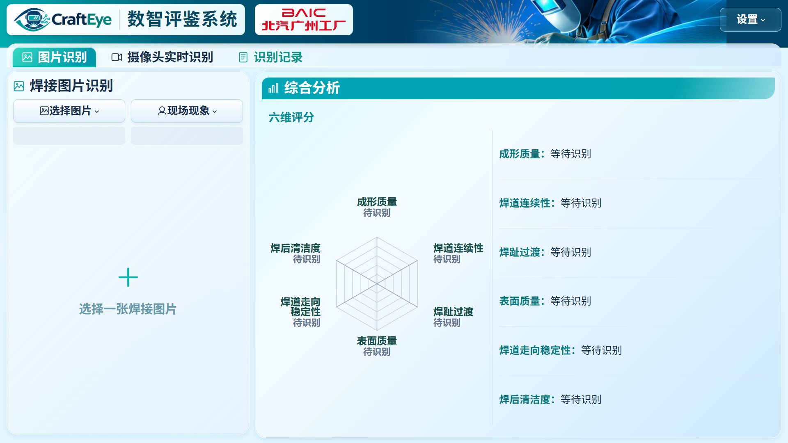
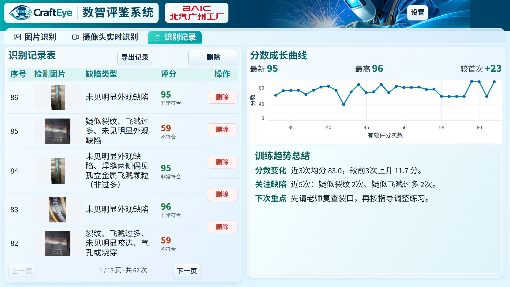
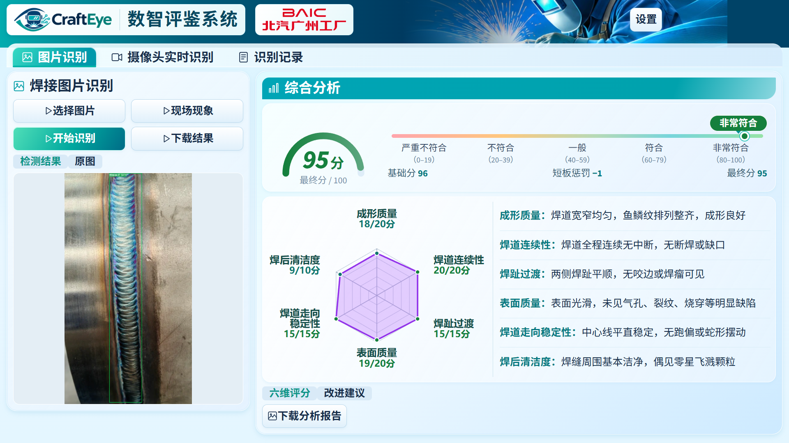
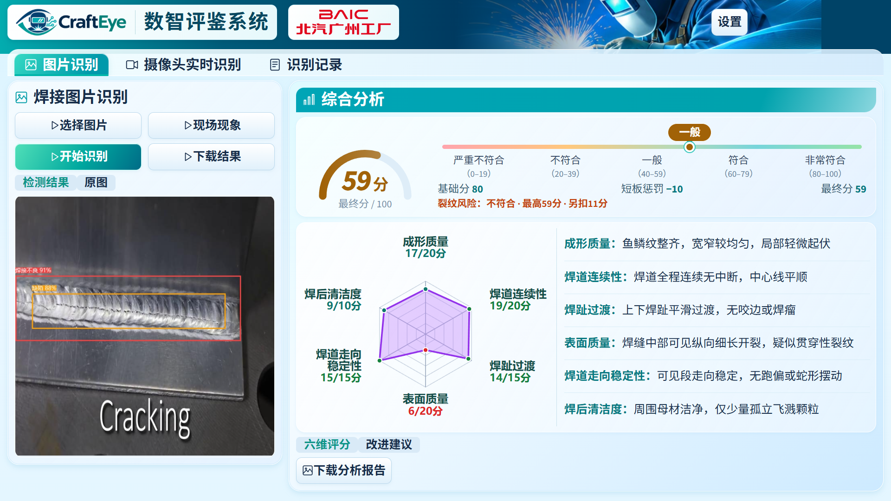
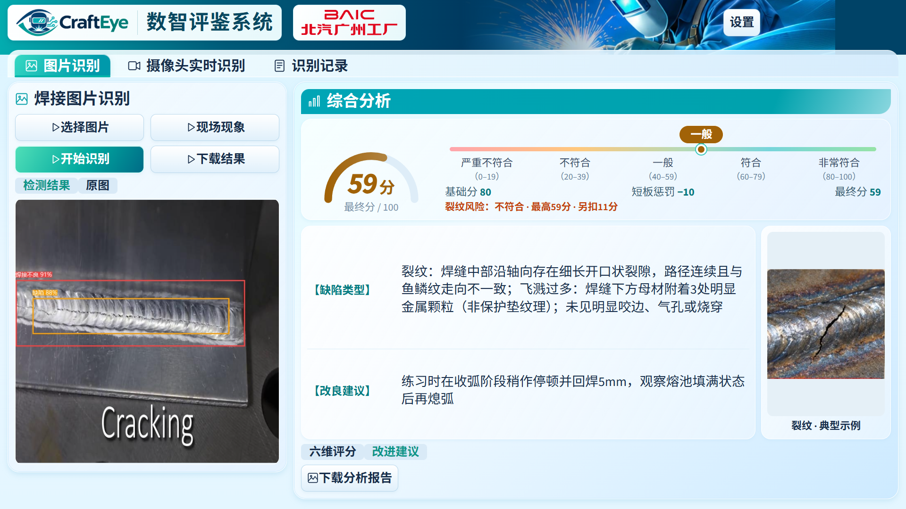

# CraftEye 数智评鉴系统

CraftEye 是面向焊接实训教学的本地视觉检测与综合评价系统。它把 YOLO 外观检测、重点区域分析、六维评分、缺陷对比和识别记录集中在一个单屏工作台中，适合课堂演示和比赛展示。

## 功能展示

### 图片识别与六维评价

上传焊接图片后，系统显示检测框，并自动生成六维外观评价、雷达图、综合分和改进建议。



### 识别记录与成长曲线

识别结果会保存为历史记录，包含检测结果图、缺陷类型、评分和详情；右侧成长曲线帮助观察训练变化。



### 优秀焊缝参考

系统支持把当前作品与代表性焊缝示例对照，帮助学生理解成形质量和评价标准。



### 缺陷重点分析

对高置信度检测区域进行局部分析，并结合裂纹、飞溅等缺陷参考图给出面向中职学生的练习建议。



### 改进建议

建议围绕“图中现象、可能原因、改良建议”组织，突出下一次练习可以直接执行的动作。



## 快速启动

Windows 下双击项目根目录的 `启动焊接识别.bat`，或在 PowerShell 中运行：

```powershell
.\.venv\Scripts\python.exe -m streamlit run app.py
```

浏览器打开 <http://127.0.0.1:8501> 即可使用。模型推理在本机完成；综合分析功能需要在网页设置中配置通义千问 API Key。

## 主要模块

- 图片识别与摄像头实时识别
- YOLO 检测框与重点区域裁图
- 六维外观评分和短板惩罚算法
- 缺陷类别参考图对比
- 识别记录、详情、删除和成长曲线
- 可下载检测图、JSON 数据和综合报告

更多运行、模型和数据说明见 [README.md](README.md)。
